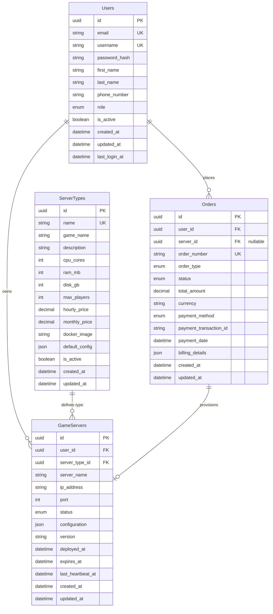

# Game Server Hosting - Database Schema Design

## Overview

This document describes the database schema for the Game Server Hosting platform. The schema is designed to support user management, game server provisioning, multiple server types, and order processing.

## Entity Relationship Diagram



## Table Definitions

### 1. Users

Stores user account information, authentication credentials, and profile data.

| Column | Type | Constraints | Description |
|--------|------|-------------|-------------|
| id | UUID | PRIMARY KEY | Unique identifier |
| email | VARCHAR(255) | UNIQUE, NOT NULL | User's email address |
| username | VARCHAR(50) | UNIQUE, NOT NULL | Unique username |
| password_hash | VARCHAR(255) | NOT NULL | Bcrypt hashed password |
| first_name | VARCHAR(100) | NOT NULL | User's first name |
| last_name | VARCHAR(100) | NOT NULL | User's last name |
| phone_number | VARCHAR(20) | NULL | Contact phone number |
| role | ENUM | NOT NULL, DEFAULT 'user' | user, admin, moderator |
| is_active | BOOLEAN | NOT NULL, DEFAULT true | Account active status |
| created_at | TIMESTAMP | NOT NULL | Account creation timestamp |
| updated_at | TIMESTAMP | NOT NULL | Last update timestamp |
| last_login_at | TIMESTAMP | NULL | Last successful login |

**Indexes:**
- `idx_users_email` on `email`
- `idx_users_username` on `username`
- `idx_users_role` on `role`

**Business Rules:**
- Email must be valid format
- Username must be 3-50 characters, alphanumeric + underscore
- Password must meet complexity requirements (enforced in application layer)
- Soft delete via `is_active` flag

---

### 2. ServerTypes

Defines available game server types with their specifications and pricing.

| Column | Type | Constraints | Description |
|--------|------|-------------|-------------|
| id | UUID | PRIMARY KEY | Unique identifier |
| name | VARCHAR(100) | UNIQUE, NOT NULL | Server type name (e.g., "Minecraft Basic") |
| game_name | VARCHAR(100) | NOT NULL | Game name (e.g., "Minecraft", "CS:GO") |
| description | TEXT | NOT NULL | Detailed description |
| cpu_cores | INTEGER | NOT NULL, CHECK > 0 | Number of CPU cores |
| ram_mb | INTEGER | NOT NULL, CHECK > 0 | RAM in megabytes |
| disk_gb | INTEGER | NOT NULL, CHECK > 0 | Disk space in gigabytes |
| max_players | INTEGER | NOT NULL, CHECK > 0 | Maximum concurrent players |
| hourly_price | DECIMAL(10,2) | NOT NULL, CHECK >= 0 | Price per hour in USD |
| monthly_price | DECIMAL(10,2) | NOT NULL, CHECK >= 0 | Price per month in USD |
| docker_image | VARCHAR(255) | NOT NULL | Docker image reference |
| default_config | JSONB | NOT NULL | Default server configuration |
| is_active | BOOLEAN | NOT NULL, DEFAULT true | Server type availability |
| created_at | TIMESTAMP | NOT NULL | Creation timestamp |
| updated_at | TIMESTAMP | NOT NULL | Last update timestamp |

**Indexes:**
- `idx_server_types_game_name` on `game_name`
- `idx_server_types_is_active` on `is_active`

**Business Rules:**
- Prices must be non-negative
- Resources (CPU, RAM, disk) must be positive
- `default_config` contains game-specific settings in JSON format
- Inactive types cannot be ordered but existing servers continue

**Example default_config:**
```json
{
  "difficulty": "normal",
  "pvp": true,
  "max_world_size": 5000,
  "backup_frequency": "daily"
}
```

---

### 3. GameServers

Represents individual game server instances owned by users.

| Column | Type | Constraints | Description |
|--------|------|-------------|-------------|
| id | UUID | PRIMARY KEY | Unique identifier |
| user_id | UUID | FOREIGN KEY, NOT NULL | Owner reference |
| server_type_id | UUID | FOREIGN KEY, NOT NULL | Server type reference |
| server_name | VARCHAR(100) | NOT NULL | Custom server name |
| ip_address | VARCHAR(45) | NULL | Assigned IP address |
| port | INTEGER | NULL, CHECK 1-65535 | Assigned port number |
| status | ENUM | NOT NULL | pending, running, stopped, suspended, terminated |
| configuration | JSONB | NOT NULL | Current server configuration |
| version | VARCHAR(50) | NOT NULL | Game/software version |
| deployed_at | TIMESTAMP | NULL | Deployment completion time |
| expires_at | TIMESTAMP | NULL | Subscription expiration time |
| last_heartbeat_at | TIMESTAMP | NULL | Last health check time |
| created_at | TIMESTAMP | NOT NULL | Creation timestamp |
| updated_at | TIMESTAMP | NOT NULL | Last update timestamp |

**Indexes:**
- `idx_game_servers_user_id` on `user_id`
- `idx_game_servers_server_type_id` on `server_type_id`
- `idx_game_servers_status` on `status`
- `idx_game_servers_expires_at` on `expires_at`
- `idx_game_servers_ip_port` on `(ip_address, port)` UNIQUE WHERE ip_address IS NOT NULL

**Foreign Keys:**
- `user_id` REFERENCES `Users(id)` ON DELETE CASCADE
- `server_type_id` REFERENCES `ServerTypes(id)` ON DELETE RESTRICT

**Business Rules:**
- Server name must be unique per user
- IP and port must be unique combination when assigned
- Status transitions: pending → running → stopped/suspended/terminated
- Heartbeat expected every 5 minutes for running servers
- Configuration inherits from ServerType.default_config and can be customized
- Expired servers (expires_at < now) should be automatically suspended

**Status Descriptions:**
- `pending`: Server order placed, awaiting provisioning
- `running`: Server is active and accessible
- `stopped`: Server temporarily stopped by user
- `suspended`: Server suspended (payment issue or expiration)
- `terminated`: Server permanently deleted

---

### 4. Orders

Tracks all purchase orders and payment transactions.

| Column | Type | Constraints | Description |
|--------|------|-------------|-------------|
| id | UUID | PRIMARY KEY | Unique identifier |
| user_id | UUID | FOREIGN KEY, NOT NULL | Customer reference |
| server_id | UUID | FOREIGN KEY, NULL | Associated server (null for failed orders) |
| order_number | VARCHAR(50) | UNIQUE, NOT NULL | Human-readable order number |
| order_type | ENUM | NOT NULL | new_server, renewal, upgrade |
| status | ENUM | NOT NULL | pending, completed, failed, refunded |
| total_amount | DECIMAL(10,2) | NOT NULL, CHECK >= 0 | Total order amount |
| currency | VARCHAR(3) | NOT NULL, DEFAULT 'USD' | ISO currency code |
| payment_method | ENUM | NOT NULL | credit_card, paypal, stripe, crypto |
| payment_transaction_id | VARCHAR(255) | NULL | External payment reference |
| payment_date | TIMESTAMP | NULL | Payment completion time |
| billing_details | JSONB | NOT NULL | Billing address and info |
| created_at | TIMESTAMP | NOT NULL | Order creation timestamp |
| updated_at | TIMESTAMP | NOT NULL | Last update timestamp |

**Indexes:**
- `idx_orders_user_id` on `user_id`
- `idx_orders_server_id` on `server_id`
- `idx_orders_order_number` on `order_number`
- `idx_orders_status` on `status`
- `idx_orders_created_at` on `created_at`

**Foreign Keys:**
- `user_id` REFERENCES `Users(id)` ON DELETE RESTRICT
- `server_id` REFERENCES `GameServers(id)` ON DELETE SET NULL

**Business Rules:**
- Order number format: `ORD-{YYYYMMDD}-{SEQUENTIAL}` (e.g., ORD-20251013-00001)
- Status transitions: pending → completed/failed → refunded (optional)
- Payment date set when status changes to completed
- Server is provisioned only after order status is completed
- Refunds create new order record with negative amount

**Example billing_details:**
```json
{
  "name": "John Doe",
  "address": "123 Main St",
  "city": "San Francisco",
  "state": "CA",
  "zip": "94102",
  "country": "USA"
}
```

---

## Relationships

### Users → GameServers (One-to-Many)
- One user can own multiple game servers
- Each game server belongs to exactly one user
- Cascade delete: When user is deleted, all their servers are deleted

### Users → Orders (One-to-Many)
- One user can place multiple orders
- Each order belongs to exactly one user
- Restrict delete: Cannot delete user with existing orders

### ServerTypes → GameServers (One-to-Many)
- One server type can be used by multiple game servers
- Each game server is based on exactly one server type
- Restrict delete: Cannot delete server type in use

### Orders → GameServers (Many-to-One)
- Multiple orders can relate to one server (initial + renewals + upgrades)
- Each order can provision one server (or none if failed)
- Set null delete: If server is deleted, order history is preserved

---

## Data Types & Conventions

### UUIDs
All primary keys use UUID (version 4) for:
- Better distribution in distributed systems
- No sequential guessing
- Easier merging of data from multiple sources

### Timestamps
All timestamp columns use UTC timezone:
- `created_at`: Set once at record creation
- `updated_at`: Updated on every modification
- Implemented via database triggers or application layer

### JSONB
PostgreSQL JSONB type for flexible schema fields:
- `default_config`: Server type defaults
- `configuration`: Server-specific settings
- `billing_details`: Order billing information
- Indexed with GIN for fast queries

### Enums
Application-level enums (stored as strings) for:
- User roles
- Server status
- Order types
- Order status
- Payment methods

---

## Security Considerations

1. **Password Storage**: Never store plain text passwords, always use bcrypt or Argon2
2. **SQL Injection**: Use parameterized queries (EF Core handles this)
3. **Soft Deletes**: Use `is_active` flags for users and server types
4. **Audit Trail**: `created_at` and `updated_at` on all tables
5. **PII Protection**: Encrypt sensitive data at rest (consider column-level encryption)
6. **Row-Level Security**: Implement authorization checks in application layer

---

## Scalability Considerations

1. **Indexing**: All foreign keys and frequently queried columns are indexed
2. **Partitioning**: Consider partitioning Orders table by date for high volume
3. **Read Replicas**: Use for reporting and analytics queries
4. **Connection Pooling**: Configure appropriate pool sizes
5. **Caching**: Cache ServerTypes (rarely change), use Redis for session data

---

## Migration Strategy

1. **Initial Schema**: Create all tables with this design
2. **Seed Data**: Populate ServerTypes with initial offerings
3. **Versioning**: Use EF Core migrations for schema evolution
4. **Backwards Compatibility**: Additive changes preferred, avoid breaking changes
5. **Testing**: Always test migrations in staging before production

---

## Future Enhancements

Potential schema extensions for future features:

1. **UserCredits**: Wallet/credit system for payments
2. **ServerBackups**: Automated backup management
3. **ServerMetrics**: Performance and usage statistics
4. **ApiKeys**: User API keys for programmatic access
5. **Invoices**: Detailed billing and invoicing
6. **ServerMods**: Mod/plugin management
7. **Teams**: Multi-user server ownership
8. **Audit Logs**: Detailed change tracking
9. **Notifications**: User notification preferences
10. **Support Tickets**: Customer support system

---

## Conclusion

This schema provides a solid foundation for a game server hosting platform with:
- ✅ User management and authentication
- ✅ Flexible server type definitions
- ✅ Server provisioning and lifecycle management
- ✅ Order processing and payment tracking
- ✅ Scalability and performance optimization
- ✅ Security best practices
- ✅ Extensibility for future features
