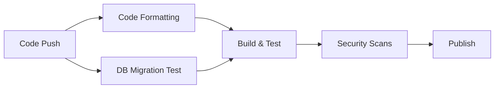

# Database Migrations Guide

This guide explains how to create and apply Entity Framework Core migrations for the Game Server Hosting project.

## Table of Contents

- [Prerequisites](#prerequisites)
- [Quick Start](#quick-start)
- [Available Commands](#available-commands)
- [Workflow Examples](#workflow-examples)
- [CI/CD Integration](#cicd-integration)
- [Best Practices](#best-practices)
- [Troubleshooting](#troubleshooting)

## Prerequisites

### Tools Required

- .NET 8.0 SDK or later
- PostgreSQL 16+ (can be run via Docker)
- EF Core tools: `dotnet tool install --global dotnet-ef`

### Database Setup

#### Option 1: Using Docker (Recommended)

```bash
# Start PostgreSQL in Docker
make docker.db.up

# Or manually with docker compose
docker compose up -d postgres
```

#### Option 2: Local PostgreSQL Installation

Ensure PostgreSQL is running and update your connection string in:
- `src/GameServerHosting.Api/appsettings.Development.json`

Default connection string:
```json
{
  "ConnectionStrings": {
    "DefaultConnection": "Host=localhost;Database=gameserverhosting_dev;Username=postgres;Password=postgres"
  }
}
```

**Important:** Enable the UUID extension before running migrations:
```sql
CREATE EXTENSION IF NOT EXISTS "uuid-ossp";
```

Or via psql:
```bash
psql -U postgres -d gameserverhosting_dev -c 'CREATE EXTENSION IF NOT EXISTS "uuid-ossp";'
```

## Quick Start

### Linux/macOS (Using Makefile)

```bash
# 1. Start the database
make docker.db.up

# 2. Apply existing migrations
make db.migrate

# 3. Create a new migration (when needed)
make db.add-migration NAME=YourMigrationName

# 4. Check migration status
make db.status
```

### Windows (Using PowerShell)

```powershell
# 1. Start the database (if using Docker)
docker compose up -d postgres

# 2. Apply existing migrations
.\scripts\db-migrations.ps1 -Command migrate

# 3. Create a new migration (when needed)
.\scripts\db-migrations.ps1 -Command add-migration -Name YourMigrationName

# 4. Check migration status
.\scripts\db-migrations.ps1 -Command status
```

## Available Commands

### Makefile Commands (Linux/macOS)

| Command | Description |
|---------|-------------|
| `make db.add-migration NAME=<name>` | Create a new migration |
| `make db.migrate` | Apply all pending migrations |
| `make db.drop` | Drop the database (with confirmation) |
| `make db.reset` | Drop and recreate database |
| `make db.status` | List all migrations and their status |
| `make docker.db.up` | Start PostgreSQL in Docker |
| `make docker.db.down` | Stop PostgreSQL container |
| `make docker.db.reset` | Remove database volume and restart |
| `make help` | Show all available commands |

### PowerShell Commands (Windows)

```powershell
# General syntax
.\scripts\db-migrations.ps1 -Command <command> [-Name <name>]

# Available commands:
# - add-migration : Create a new migration (requires -Name)
# - migrate       : Apply all pending migrations
# - drop          : Drop the database
# - reset         : Drop and recreate database
# - status        : Show migration status
# - help          : Show help message
```

## Workflow Examples

### Creating Your First Migration

When you make changes to your entity models or DbContext:

```bash
# Linux/macOS
make db.add-migration NAME=AddNewFeature

# Windows
.\scripts\db-migrations.ps1 -Command add-migration -Name AddNewFeature
```

This will:
1. Generate migration files in `src/GameServerHosting.Infrastructure/Data/Migrations/`
2. Create both `Up()` and `Down()` methods for the migration

### Applying Migrations to Your Database

```bash
# Linux/macOS
make db.migrate

# Windows
.\scripts\db-migrations.ps1 -Command migrate
```

This applies all pending migrations to your local database.

### Checking Migration Status

```bash
# Linux/macOS
make db.status

# Windows
.\scripts\db-migrations.ps1 -Command status
```

This shows:
- All available migrations
- Which migrations have been applied
- Which migrations are pending

### Resetting Your Database

⚠️ **WARNING**: This will delete all data!

```bash
# Linux/macOS
make db.reset

# Windows
.\scripts\db-migrations.ps1 -Command reset
```

This is useful when:
- You want a clean database state
- Testing migrations from scratch
- Resolving migration conflicts

## CI/CD Integration

### Automated Migration Testing

Every pull request automatically tests migrations in the CI pipeline:

1. **Database Migration Test Job**
   - Spins up a PostgreSQL container
   - Applies all migrations to a clean database
   - Verifies database schema creation
   - Tests migration rollback (if multiple migrations exist)

2. **Integration Tests** (future)
   - Run against a database with applied migrations
   - Test API endpoints with actual database operations

### CI Pipeline Workflow



The CI pipeline ensures that:
- ✅ Migrations apply cleanly to an empty database
- ✅ Database schema is created correctly
- ✅ Migrations can be rolled back (when applicable)
- ✅ No SQL syntax errors or constraint violations

## Best Practices

### 1. Migration Naming Conventions

Use descriptive names that explain what the migration does:

```bash
# Good examples
make db.add-migration NAME=AddUserPreferences
make db.add-migration NAME=AddOrderStatusIndex
make db.add-migration NAME=UpdateServerTypeConstraints

# Bad examples
make db.add-migration NAME=Update1
make db.add-migration NAME=Fix
make db.add-migration NAME=Migration2
```

### 2. Review Generated Migrations

Always review the generated migration files before applying them:

```bash
# After creating a migration, review the files:
# src/GameServerHosting.Infrastructure/Data/Migrations/<timestamp>_<name>.cs
# src/GameServerHosting.Infrastructure/Data/Migrations/<timestamp>_<name>.Designer.cs
```

Check for:
- Correct column types and constraints
- Proper foreign key relationships
- Expected indexes
- Data loss warnings

### 3. Test Migrations Locally

Before pushing your changes:

```bash
# Test applying the migration
make db.migrate

# Test your application with the new schema
dotnet run --project src/GameServerHosting.Api

# Optional: Test rollback
cd src/GameServerHosting.Infrastructure
dotnet ef database update <PreviousMigrationName>
```

### 4. Avoid Direct Database Modifications

❌ **Don't do this:**
- Manually modifying the database schema
- Editing existing migration files after they've been committed
- Deleting migration files from version control

✅ **Do this instead:**
- Create new migrations for schema changes
- Use `db.reset` if you need to recreate your local database
- Keep all migrations in version control

### 5. Production Migration Strategy

⚠️ **IMPORTANT**: Never auto-migrate production databases!

For production deployments:

1. **Review migrations** in staging environment
2. **Backup production database** before applying migrations
3. **Apply migrations manually** or via controlled deployment scripts
4. **Monitor application** after migration

```bash
# Production migration (example - adapt to your deployment process)
dotnet ef database update \
  --project src/GameServerHosting.Infrastructure \
  --startup-project src/GameServerHosting.Api \
  --context GameServerDbContext \
  --connection "<production-connection-string>"
```

### 6. Handling Data Migrations

When you need to migrate data along with schema changes:

```csharp
// Example: Migration with data transformation
protected override void Up(MigrationBuilder migrationBuilder)
{
    // 1. Add new column
    migrationBuilder.AddColumn<string>(
        name: "full_name",
        table: "users",
        nullable: true);

    // 2. Migrate data from old columns
    migrationBuilder.Sql(@"
        UPDATE users 
        SET full_name = CONCAT(first_name, ' ', last_name)
        WHERE full_name IS NULL;
    ");

    // 3. Make column non-nullable
    migrationBuilder.AlterColumn<string>(
        name: "full_name",
        table: "users",
        nullable: false);
}
```

## Troubleshooting

### Common Issues

#### Issue: "Build failed" when creating migration

**Solution**: Ensure the solution builds successfully first:

```bash
dotnet build GameServerHosting.sln
```

#### Issue: "Unable to create DbContext"

**Solution**: Check that:
1. PostgreSQL is running: `docker compose ps postgres`
2. Connection string is correct in `appsettings.Development.json`
3. Database exists: `docker compose exec postgres psql -U postgres -l`

#### Issue: Migration fails with "duplicate key" or constraint errors

**Solution**: 
1. Check if you have data that violates the new constraints
2. Reset your local database: `make db.reset`
3. Review the migration for correctness

#### Issue: "A migration with the name 'X' already exists"

**Solution**: Choose a different, more specific name:

```bash
# Instead of generic names
make db.add-migration NAME=UpdateSchema

# Use specific names
make db.add-migration NAME=AddServerTypeDescription
```

#### Issue: "function uuid_generate_v4() does not exist"

**Solution**: The PostgreSQL database needs the `uuid-ossp` extension:

```bash
# Using Docker
docker compose exec postgres psql -U postgres -d gameserverhosting_dev \
  -c 'CREATE EXTENSION IF NOT EXISTS "uuid-ossp";'

# Or using psql directly
psql -U postgres -d gameserverhosting_dev \
  -c 'CREATE EXTENSION IF NOT EXISTS "uuid-ossp";'
```

Note: When using `make docker.db.up`, this extension should be enabled automatically on first migration run. If it's not, run the command above manually.

#### Issue: Can't connect to database in Docker

**Solution**:

```bash
# Check if PostgreSQL container is running
docker compose ps postgres

# Check PostgreSQL logs
docker compose logs postgres

# Restart PostgreSQL
make docker.db.down
make docker.db.up
```

### Getting Help

If you encounter issues not covered here:

1. Check the [EF Core Documentation](https://learn.microsoft.com/en-us/ef/core/)
2. Review CI pipeline logs for migration test failures
3. Consult with the team in the #database channel

## Additional Resources

- [EF Core Migrations Overview](https://learn.microsoft.com/en-us/ef/core/managing-schemas/migrations/)
- [PostgreSQL Documentation](https://www.postgresql.org/docs/)
- [Project Architecture Documentation](./architecture.md)
- [API Development Guide](./api-development.md)

## Summary

**Key Takeaways:**

✅ Use `make db.add-migration NAME=<name>` to create migrations  
✅ Use `make db.migrate` to apply migrations locally  
✅ Always review generated migrations before committing  
✅ Test migrations locally before pushing  
✅ CI automatically tests all migrations  
✅ Never auto-migrate production - use controlled deployment  
✅ Keep all migrations in version control  

---

**Last Updated**: 2025-10-16  
**Maintained By**: Development Team
