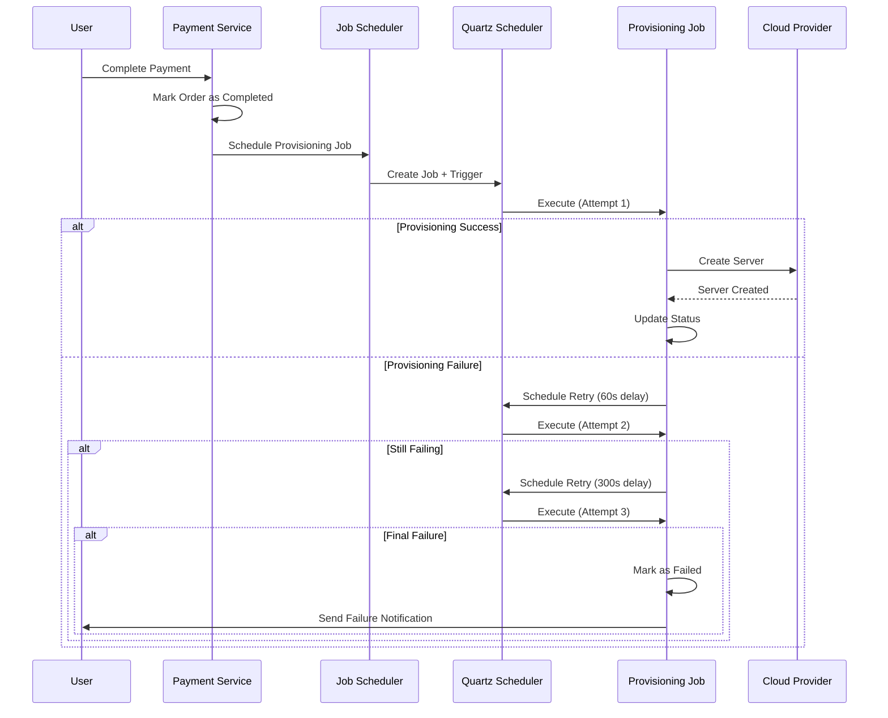

# Background Job Processing with Quartz.NET

## Overview

The Game Server Hosting platform uses Quartz.NET for robust background job processing. This document describes the implementation, configuration, and usage of the background job system.

## Features

- **Automated Job Scheduling**: Jobs are automatically scheduled when orders are completed
- **Retry Logic**: Failed jobs are automatically retried with exponential backoff
- **Health Check Monitoring**: Periodic health checks for all running servers
- **Job Management API**: REST API endpoints for manual job control
- **Configurable Settings**: All job settings can be configured via appsettings.json

## Architecture

### Job Types

#### 1. Server Provisioning Job
- **Purpose**: Provisions game servers after successful payment
- **Trigger**: Automatically scheduled when an order is completed
- **Retry Policy**: 3 attempts with exponential backoff (60s, 300s, 900s)
- **Concurrency**: Prevented by `[DisallowConcurrentExecution]` attribute

#### 2. Server Health Check Job
- **Purpose**: Monitors health of all running game servers
- **Trigger**: Scheduled via cron expression (every 5 minutes in production, 2 minutes in development)
- **Retry Policy**: No retry - next scheduled run will handle failures
- **Concurrency**: Prevented by `[DisallowConcurrentExecution]` attribute

### Components

```
┌─────────────────────────────────────────────────────────────┐
│                      Quartz.NET Scheduler                    │
│  - Thread Pool (10 threads)                                  │
│  - In-Memory Job Store (RAMJobStore)                         │
│  - Job History Logging Plugin                                │
└─────────────────────────────────────────────────────────────┘
                              │
                              ├─────────────────────────────────┐
                              ▼                                 ▼
                    ┌─────────────────────┐       ┌─────────────────────┐
                    │  Provisioning Jobs  │       │  Health Check Jobs  │
                    │  (On-Demand)        │       │  (Scheduled)        │
                    └─────────────────────┘       └─────────────────────┘
                              │                                 │
                              ▼                                 ▼
                    ┌─────────────────────┐       ┌─────────────────────┐
                    │ ServerProvisioning  │       │ ServerHealthCheck   │
                    │ Job                 │       │ Job                 │
                    └─────────────────────┘       └─────────────────────┘
```

## Configuration

### appsettings.json

```json
{
  "Quartz": {
    "quartz.scheduler.instanceName": "GameServerHostingScheduler",
    "quartz.scheduler.instanceId": "AUTO",
    "quartz.threadPool.threadCount": 10,
    "quartz.jobStore.type": "Quartz.Simpl.RAMJobStore, Quartz",
    "quartz.serializer.type": "json"
  },
  "Jobs": {
    "HealthCheck": {
      "Enabled": true,
      "CronSchedule": "0 0/5 * * * ?",
      "Description": "Runs every 5 minutes to check server health"
    },
    "Provisioning": {
      "MaxRetries": 3,
      "RetryIntervalSeconds": [ 60, 300, 900 ],
      "Description": "Retries: 1 minute, 5 minutes, 15 minutes"
    }
  }
}
```

### Cron Schedule Format

The health check job uses Quartz cron expressions:
- `0 0/5 * * * ?` - Every 5 minutes
- `0 0/2 * * * ?` - Every 2 minutes (development)
- `0 0 0/1 * * ?` - Every hour
- `0 0 12 * * ?` - Every day at noon

Format: `second minute hour day-of-month month day-of-week [year]`

## Retry Logic

### Exponential Backoff Strategy

Provisioning jobs implement automatic retry with exponential backoff:

1. **First Attempt**: Immediate execution
2. **Retry 1**: Wait 60 seconds
3. **Retry 2**: Wait 300 seconds (5 minutes)
4. **Retry 3**: Wait 900 seconds (15 minutes)
5. **Final Failure**: Job marked as failed, manual intervention required

### Retry Configuration

The retry behavior can be customized in `appsettings.json`:

```json
{
  "Jobs": {
    "Provisioning": {
      "MaxRetries": 3,
      "RetryIntervalSeconds": [ 60, 300, 900 ]
    }
  }
}
```

## API Endpoints

### Schedule Provisioning Job

```http
POST /api/jobs/provisioning/{orderId}?delaySeconds=0
Authorization: Bearer {token}
```

**Response:**
```json
{
  "jobKey": "provisioning.provision-{orderId}",
  "orderId": "guid",
  "scheduledAt": "2025-10-15T10:30:00Z",
  "delaySeconds": 0,
  "message": "Provisioning job scheduled successfully"
}
```

### Cancel Provisioning Job

```http
DELETE /api/jobs/provisioning?jobKey=provisioning.provision-{orderId}
Authorization: Bearer {token}
```

**Response:**
```json
{
  "message": "Job cancelled successfully",
  "jobKey": "provisioning.provision-{orderId}"
}
```

### Get Job Status

```http
GET /api/jobs/status?jobKey=provisioning.provision-{orderId}
Authorization: Bearer {token}
```

**Response:**
```json
{
  "jobKey": "provisioning.provision-{orderId}",
  "jobType": "QuartzServerProvisioningJob",
  "state": "Normal",
  "nextFireTime": "2025-10-15T10:35:00Z",
  "previousFireTime": null,
  "refireCount": 0,
  "jobData": {
    "orderId": "guid"
  }
}
```

## Job Scheduling Flow

### Automatic Provisioning Flow



## Implementation Details

### Job Classes

#### QuartzServerProvisioningJob

Located at: `src/GameServerHosting.Api/Jobs/QuartzServerProvisioningJob.cs`

Key features:
- Wraps the core `ServerProvisioningJob` logic
- Implements retry logic with exponential backoff
- Tracks attempt count and schedules retries
- Logs all attempts and failures

#### QuartzServerHealthCheckJob

Located at: `src/GameServerHosting.Api/Jobs/QuartzServerHealthCheckJob.cs`

Key features:
- Wraps the core `ServerHealthCheckJob` logic
- Runs on a cron schedule
- Does not retry (next scheduled run handles failures)
- Checks all running servers for health issues

### Service Classes

#### JobSchedulerService

Located at: `src/GameServerHosting.Api/Services/JobSchedulerService.cs`

Provides methods for:
- Scheduling provisioning jobs dynamically
- Cancelling scheduled jobs
- Querying job status
- Managing job lifecycle

#### QuartzRetryPolicy

Located at: `src/GameServerHosting.Api/Services/QuartzRetryPolicy.cs`

Utility class for:
- Calculating retry delays
- Creating retry triggers
- Determining if retry should occur
- Building job data with retry configuration

## Monitoring and Logging

### Structured Logging

All job executions are logged with structured logging:

```csharp
_logger.LogInformation(
    "Quartz job executing provisioning for order {OrderId} (Attempt {Attempt} of {MaxAttempts})",
    orderId,
    currentAttempt + 1,
    maxRetries + 1);
```

### Log Levels

- **Information**: Normal job execution, successful completions
- **Warning**: Retry attempts, non-critical issues
- **Error**: Job failures, exceptions

### Log Output

Logs are written to:
- Console (structured format)
- File: `logs/gameserver-.log` (daily rolling)

Example log entries:
```
[2025-10-15 10:30:00.123 UTC] [INF] [QuartzServerProvisioningJob] Quartz job executing provisioning for order abc123 (Attempt 1 of 4)
[2025-10-15 10:30:15.456 UTC] [INF] [QuartzServerProvisioningJob] Quartz job completed successfully for order abc123
```

## Testing

### Manual Job Scheduling

Use the Jobs API to manually trigger provisioning:

```bash
# Schedule a provisioning job immediately
curl -X POST "http://localhost:5000/api/jobs/provisioning/123e4567-e89b-12d3-a456-426614174000" \
  -H "Authorization: Bearer YOUR_TOKEN"

# Schedule with delay
curl -X POST "http://localhost:5000/api/jobs/provisioning/123e4567-e89b-12d3-a456-426614174000?delaySeconds=60" \
  -H "Authorization: Bearer YOUR_TOKEN"
```

### Check Job Status

```bash
curl -X GET "http://localhost:5000/api/jobs/status?jobKey=provisioning.provision-123e4567-e89b-12d3-a456-426614174000" \
  -H "Authorization: Bearer YOUR_TOKEN"
```

### Health Check Verification

Health checks run automatically based on the configured cron schedule. Check logs to verify execution:

```bash
grep "QuartzServerHealthCheckJob" logs/gameserver-*.log
```

## Troubleshooting

### Common Issues

#### Jobs Not Starting

**Symptom**: Jobs are scheduled but never execute

**Possible Causes**:
1. Quartz hosted service not started
2. Thread pool exhausted
3. Job store issues

**Solution**:
- Check logs for Quartz startup messages
- Verify `AddQuartzHostedService` is called in `Program.cs`
- Increase thread pool size if needed

#### Jobs Failing Immediately

**Symptom**: All retry attempts fail quickly

**Possible Causes**:
1. Invalid order ID
2. Missing dependencies
3. Database connection issues

**Solution**:
- Check job logs for exception details
- Verify order exists and is in correct state
- Test provisioning service independently

#### Retry Not Working

**Symptom**: Failed jobs don't retry

**Possible Causes**:
1. Retry configuration not loaded
2. Exception handling preventing retry
3. Scheduler instance issues

**Solution**:
- Verify `Jobs:Provisioning` configuration in appsettings
- Check exception handling in job code
- Review scheduler logs

## Best Practices

1. **Job Idempotency**: Design jobs to be safely retryable
2. **Timeout Configuration**: Set appropriate timeouts for long-running operations
3. **Error Handling**: Catch and log all exceptions appropriately
4. **State Management**: Track job state in the database
5. **Monitoring**: Set up alerts for repeated job failures
6. **Testing**: Test retry logic with simulated failures

## Production Considerations

### Performance

- **Thread Pool Size**: Default 10 threads, adjust based on load
- **Concurrent Jobs**: Each provisioning job uses one thread
- **Memory Usage**: RAMJobStore keeps all jobs in memory

### Scaling

For high-volume scenarios, consider:
1. **Persistent Job Store**: Switch from RAMJobStore to database-backed store
2. **Distributed Scheduling**: Use AdoJobStore with clustering
3. **Job Queue Limits**: Implement queue depth monitoring
4. **Load Balancing**: Distribute jobs across multiple instances

### Security

- **API Authorization**: All job endpoints require authentication
- **Job Data Validation**: Validate all job parameters
- **Rate Limiting**: Consider rate limits for manual job scheduling

## References

- [Quartz.NET Documentation](https://www.quartz-scheduler.net/documentation/)
- [Cron Expression Guide](https://www.quartz-scheduler.net/documentation/quartz-3.x/tutorial/crontriggers.html)
- [Quartz.NET Best Practices](https://www.quartz-scheduler.net/documentation/best-practices.html)
