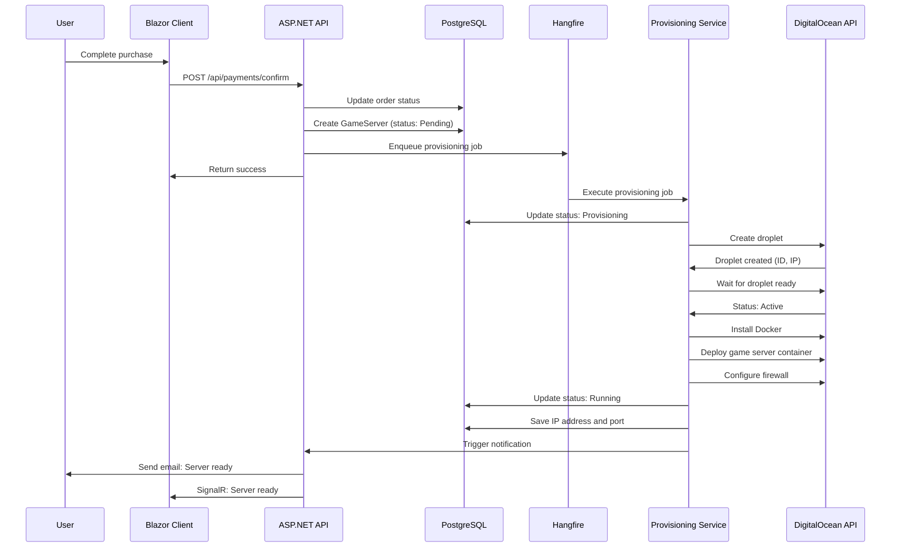
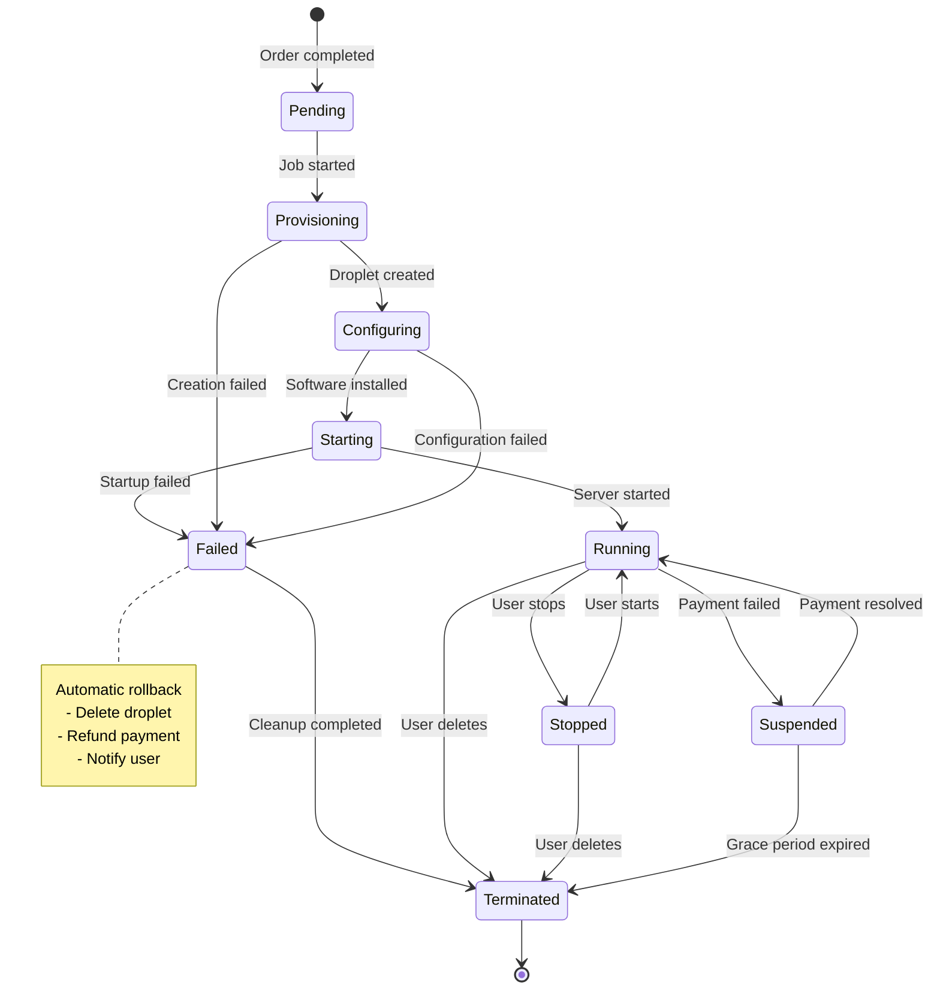

# Server Provisioning System Design

## Executive Summary

This document defines the architecture and implementation plan for the game server provisioning system. The system enables automated deployment of game servers on cloud infrastructure providers, with support for multiple providers through a unified interface.

**Key Decisions:**
- **Primary Provider**: DigitalOcean (with abstraction for future multi-provider support)
- **Architecture Pattern**: Strategy pattern with provider abstraction layer
- **Job Processing**: Hangfire for asynchronous provisioning
- **State Management**: Well-defined state machine with rollback capabilities
- **Deployment Method**: Docker containers on cloud VMs

---

## Table of Contents

1. [Infrastructure Provider Selection](#1-infrastructure-provider-selection)
2. [Provisioning Workflow](#2-provisioning-workflow)
3. [System Architecture](#3-system-architecture)
4. [API Integration Design](#4-api-integration-design)
5. [Implementation Details](#5-implementation-details)
6. [Security Considerations](#6-security-considerations)
7. [Monitoring & Observability](#7-monitoring--observability)
8. [Error Handling & Recovery](#8-error-handling--recovery)
9. [Cost Analysis](#9-cost-analysis)
10. [Implementation Roadmap](#10-implementation-roadmap)

---

## 1. Infrastructure Provider Selection

### 1.1 Provider Comparison

| Criteria | DigitalOcean | AWS | Azure |
|----------|--------------|-----|-------|
| **API Complexity** | ⭐⭐⭐⭐⭐ Simple REST API | ⭐⭐⭐ Complex SDK | ⭐⭐⭐ Complex SDK |
| **Pricing Model** | ⭐⭐⭐⭐⭐ Fixed hourly rates | ⭐⭐⭐ Variable pricing | ⭐⭐⭐ Variable pricing |
| **Game Server Suitability** | ⭐⭐⭐⭐⭐ Optimized network | ⭐⭐⭐⭐ Good | ⭐⭐⭐⭐ Good |
| **Documentation** | ⭐⭐⭐⭐⭐ Excellent | ⭐⭐⭐⭐ Good | ⭐⭐⭐⭐ Good |
| **Cost (Entry Level)** | ⭐⭐⭐⭐⭐ $6/month | ⭐⭐⭐ $8-10/month | ⭐⭐⭐ $10-15/month |
| **Global Coverage** | ⭐⭐⭐⭐ 14 regions | ⭐⭐⭐⭐⭐ 30+ regions | ⭐⭐⭐⭐⭐ 60+ regions |
| **Setup Time** | ⭐⭐⭐⭐⭐ 55 seconds | ⭐⭐⭐ 2-3 minutes | ⭐⭐⭐ 2-3 minutes |
| **C# SDK Quality** | ⭐⭐⭐⭐ Community | ⭐⭐⭐⭐⭐ Official | ⭐⭐⭐⭐⭐ Official |

### 1.2 Recommended Approach: DigitalOcean Primary, Multi-Provider Ready

**Primary Provider: DigitalOcean**

**Rationale:**
1. **Simplicity**: Straightforward REST API reduces development time and maintenance burden
2. **Cost-Effective**: Predictable pricing ideal for startup phase
3. **Game Server Optimized**: Low-latency networking, good for real-time multiplayer
4. **Fast Provisioning**: ~55 second average droplet creation time
5. **Developer-Friendly**: Excellent documentation and community support

**Architecture Advantage:**
- Design with provider abstraction layer from day one
- Easy to add AWS/Azure later as business scales
- Allows customers to choose provider based on region/price preferences

### 1.3 DigitalOcean Specifications

**Available Droplet Sizes for Game Servers:**

| Plan Name | vCPUs | RAM | Storage | Transfer | Price/mo | Ideal For |
|-----------|-------|-----|---------|----------|----------|-----------|
| Basic-1 | 1 | 1 GB | 25 GB SSD | 1 TB | $6 | Small Minecraft, Terraria |
| Basic-2 | 1 | 2 GB | 50 GB SSD | 2 TB | $12 | Medium Minecraft, Valheim |
| Basic-4 | 2 | 4 GB | 80 GB SSD | 4 TB | $24 | CS:GO, Rust (small) |
| General-8 | 2 | 8 GB | 160 GB SSD | 5 TB | $48 | Rust, ARK, modded servers |
| General-16 | 4 | 16 GB | 320 GB SSD | 6 TB | $96 | Large ARK, heavily modded |

**Data Centers (14 Global Regions):**
- **North America**: NYC1, NYC2, NYC3, SFO1, SFO2, SFO3, TOR1
- **Europe**: LON1, FRA1, AMS3
- **Asia-Pacific**: SGP1, BLR1
- **India**: BLR1

---

## 2. Provisioning Workflow

### 2.1 High-Level Flow



### 2.2 Detailed State Machine



### 2.3 Provisioning Steps Breakdown

#### Step 1: Pre-Provisioning Validation (30 seconds)
```
1. Validate order status = Completed
2. Validate payment confirmed
3. Check user account active
4. Verify server plan exists
5. Reserve IP/port range
6. Create GameServer record (status: Pending)
```

#### Step 2: Droplet Creation (55 seconds average)
```
1. Select region based on user preference or auto-select
2. Choose droplet size based on ServerPlan specifications
3. Generate SSH key pair for server management
4. Create droplet via DigitalOcean API
5. Store droplet ID and credentials
6. Update status: Provisioning
```

#### Step 3: Droplet Initialization (60-90 seconds)
```
1. Poll droplet status until "active"
2. Wait for SSH to be available
3. Update server record with IP address
4. Configure hostname
5. Update status: Configuring
```

#### Step 4: Software Installation (90-120 seconds)
```
1. Update system packages (apt update)
2. Install Docker and Docker Compose
3. Configure Docker daemon
4. Pull game server Docker image
5. Create server configuration files
6. Setup log rotation
```

#### Step 5: Game Server Deployment (30-60 seconds)
```
1. Generate docker-compose.yml with configuration
2. Start game server container
3. Verify container health
4. Configure firewall rules (UFW)
5. Open required game ports
6. Update status: Starting
```

#### Step 6: Health Check & Finalization (30 seconds)
```
1. Wait for game server to accept connections
2. Perform health check (ping game port)
3. Save final configuration to database
4. Update status: Running
5. Send notification to user (email + SignalR)
6. Log provisioning metrics
```

**Total Estimated Time: 4-6 minutes**

### 2.4 State Descriptions

| State | Description | User Actions | System Actions |
|-------|-------------|--------------|----------------|
| **Pending** | Order completed, awaiting provisioning | None | Queue provisioning job |
| **Provisioning** | Creating cloud infrastructure | None | Create droplet, assign IP |
| **Configuring** | Installing software | None | Install Docker, configure OS |
| **Starting** | Launching game server | None | Start container, open ports |
| **Running** | Server active and accessible | Start, Stop, Restart, Configure, Delete | Health monitoring |
| **Stopped** | Server paused by user | Start, Delete | Maintain data, pause billing |
| **Suspended** | Auto-suspended (payment/expiry) | Add payment | Auto-delete after grace period |
| **Failed** | Provisioning failed | Delete, Retry | Rollback, refund, notify |
| **Terminated** | Permanently deleted | None | Delete all resources |

---

## 3. System Architecture

### 3.1 Component Diagram

```
┌─────────────────────────────────────────────────────────────────┐
│                      ASP.NET Core API                            │
│                                                                   │
│  ┌────────────────────────────────────────────────────────┐    │
│  │                   Controllers                           │    │
│  │  • OrdersController                                     │    │
│  │  • PaymentsController                                   │    │
│  │  • GameServersController                                │    │
│  └───────────────────┬────────────────────────────────────┘    │
│                      │                                           │
│  ┌───────────────────▼────────────────────────────────────┐    │
│  │                Service Layer                            │    │
│  │                                                          │    │
│  │  ┌──────────────────────────────────────────────┐      │    │
│  │  │  IServerProvisioningService                  │      │    │
│  │  │  - ProvisionServerAsync()                    │      │    │
│  │  │  - GetProvisioningStatusAsync()              │      │    │
│  │  │  - RollbackProvisioningAsync()               │      │    │
│  │  └────────────────┬─────────────────────────────┘      │    │
│  │                   │                                      │    │
│  │  ┌────────────────▼──────────────────────────────┐     │    │
│  │  │  ICloudProviderService (Strategy)            │     │    │
│  │  │  - CreateServerAsync()                        │     │    │
│  │  │  - GetServerStatusAsync()                     │     │    │
│  │  │  - DeleteServerAsync()                        │     │    │
│  │  │  - ConfigureServerAsync()                     │     │    │
│  │  └────────────────┬──────────────────────────────┘     │    │
│  │                   │                                      │    │
│  │       ┌───────────┴────────────┬─────────────────┐     │    │
│  │       │                        │                 │     │    │
│  │  ┌────▼─────────┐  ┌──────────▼──────┐  ┌──────▼───┐ │    │
│  │  │ DigitalOcean │  │   AWS Service   │  │  Azure   │ │    │
│  │  │   Provider   │  │   (Future)      │  │ Provider │ │    │
│  │  │   Service    │  │                 │  │ (Future) │ │    │
│  │  └──────────────┘  └─────────────────┘  └──────────┘ │    │
│  └─────────────────────────────────────────────────────────┘    │
│                                                                   │
│  ┌─────────────────────────────────────────────────────────┐    │
│  │              Hangfire Background Jobs                    │    │
│  │  • ServerProvisioningJob                                 │    │
│  │  • ServerHealthCheckJob                                  │    │
│  │  • ServerCleanupJob                                      │    │
│  └─────────────────────────────────────────────────────────┘    │
└───────────────────────────────────────────────────────────────────┘
         │                           │                      │
         ▼                           ▼                      ▼
┌─────────────────┐     ┌────────────────────┐   ┌─────────────────┐
│   PostgreSQL    │     │  DigitalOcean API  │   │   Email/SignalR │
│   Database      │     │  (HTTP REST)       │   │   Notifications │
└─────────────────┘     └────────────────────┘   └─────────────────┘
```

### 3.2 Class Structure

```csharp
// Core abstraction
public interface ICloudProviderService
{
    Task<ProvisionResult> CreateServerAsync(ServerProvisionRequest request);
    Task<ServerInfo> GetServerStatusAsync(string providerId);
    Task<bool> StartServerAsync(string providerId);
    Task<bool> StopServerAsync(string providerId);
    Task<bool> RestartServerAsync(string providerId);
    Task<bool> DeleteServerAsync(string providerId);
    Task<ServerMetrics> GetServerMetricsAsync(string providerId);
}

// Provisioning orchestration
public interface IServerProvisioningService
{
    Task<Guid> ProvisionServerAsync(Guid orderId);
    Task<ProvisioningStatus> GetProvisioningStatusAsync(Guid serverId);
    Task<bool> RollbackProvisioningAsync(Guid serverId, string reason);
    Task<bool> ValidateProvisioningAsync(Guid serverId);
}

// Server lifecycle management
public interface IServerManagementService
{
    Task<bool> StartServerAsync(Guid serverId);
    Task<bool> StopServerAsync(Guid serverId);
    Task<bool> RestartServerAsync(Guid serverId);
    Task<bool> DeleteServerAsync(Guid serverId);
    Task<ServerHealthStatus> CheckServerHealthAsync(Guid serverId);
}
```

---

## 4. API Integration Design

### 4.1 DigitalOcean API Integration

**Authentication:**
- Bearer token authentication
- API token stored in Azure Key Vault
- Token rotation support

**Primary Endpoints Used:**

```http
# Create Droplet
POST https://api.digitalocean.com/v2/droplets
Authorization: Bearer {token}
Content-Type: application/json

{
  "name": "game-server-{guid}",
  "region": "nyc3",
  "size": "s-2vcpu-4gb",
  "image": "docker-20-04",
  "ssh_keys": ["{ssh_key_id}"],
  "backups": false,
  "ipv6": true,
  "monitoring": true,
  "tags": ["game-server", "user-{userId}", "plan-{planId}"]
}

# Get Droplet Status
GET https://api.digitalocean.com/v2/droplets/{droplet_id}

# Delete Droplet
DELETE https://api.digitalocean.com/v2/droplets/{droplet_id}

# Get Droplet Metrics
GET https://api.digitalocean.com/v2/monitoring/metrics/droplet/{droplet_id}
```

### 4.2 C# Implementation Example

```csharp
public class DigitalOceanProviderService : ICloudProviderService
{
    private readonly HttpClient _httpClient;
    private readonly ILogger<DigitalOceanProviderService> _logger;
    private readonly DigitalOceanSettings _settings;

    public async Task<ProvisionResult> CreateServerAsync(ServerProvisionRequest request)
    {
        try
        {
            // Step 1: Create droplet
            var dropletRequest = new
            {
                name = $"gameserver-{request.ServerId}",
                region = request.Region ?? "nyc3",
                size = MapServerPlanToDropletSize(request.ServerPlan),
                image = "docker-20-04",
                ssh_keys = new[] { _settings.SshKeyId },
                monitoring = true,
                tags = new[] 
                { 
                    "game-server", 
                    $"user-{request.UserId}",
                    $"plan-{request.ServerPlanId}"
                }
            };

            var response = await _httpClient.PostAsJsonAsync(
                "https://api.digitalocean.com/v2/droplets", 
                dropletRequest
            );

            response.EnsureSuccessStatusCode();
            var result = await response.Content.ReadFromJsonAsync<DropletResponse>();

            // Step 2: Wait for droplet to be active
            await WaitForDropletActive(result.Droplet.Id);

            // Step 3: Get IP address
            var droplet = await GetDropletDetails(result.Droplet.Id);

            return new ProvisionResult
            {
                Success = true,
                ProviderId = result.Droplet.Id.ToString(),
                IpAddress = droplet.Networks.V4.FirstOrDefault()?.IpAddress,
                ProvisionedAt = DateTime.UtcNow
            };
        }
        catch (Exception ex)
        {
            _logger.LogError(ex, "Failed to provision server on DigitalOcean");
            return new ProvisionResult
            {
                Success = false,
                ErrorMessage = ex.Message
            };
        }
    }

    private string MapServerPlanToDropletSize(ServerPlan plan)
    {
        // Map internal server plans to DigitalOcean sizes
        return plan.RAM switch
        {
            <= 1024 => "s-1vcpu-1gb",
            <= 2048 => "s-1vcpu-2gb",
            <= 4096 => "s-2vcpu-4gb",
            <= 8192 => "s-4vcpu-8gb",
            _ => "s-6vcpu-16gb"
        };
    }

    private async Task WaitForDropletActive(int dropletId, int maxWaitSeconds = 180)
    {
        var stopwatch = Stopwatch.StartNew();
        while (stopwatch.Elapsed.TotalSeconds < maxWaitSeconds)
        {
            var status = await GetServerStatusAsync(dropletId.ToString());
            if (status.Status == "active")
                return;

            await Task.Delay(5000); // Check every 5 seconds
        }

        throw new TimeoutException($"Droplet {dropletId} did not become active within {maxWaitSeconds} seconds");
    }
}
```

### 4.3 Configuration Models

```csharp
public class DigitalOceanSettings
{
    public string ApiToken { get; set; }
    public string DefaultRegion { get; set; } = "nyc3";
    public string SshKeyId { get; set; }
    public int ProvisioningTimeoutSeconds { get; set; } = 300;
    public bool EnableMonitoring { get; set; } = true;
    public bool EnableBackups { get; set; } = false;
}

public class ServerProvisionRequest
{
    public Guid ServerId { get; set; }
    public Guid UserId { get; set; }
    public Guid ServerPlanId { get; set; }
    public ServerPlan ServerPlan { get; set; }
    public ServerType ServerType { get; set; }
    public string Region { get; set; }
    public Dictionary<string, string> Configuration { get; set; }
}

public class ProvisionResult
{
    public bool Success { get; set; }
    public string ProviderId { get; set; } // DigitalOcean droplet ID
    public string IpAddress { get; set; }
    public int? Port { get; set; }
    public DateTime? ProvisionedAt { get; set; }
    public string ErrorMessage { get; set; }
    public Dictionary<string, string> Metadata { get; set; }
}
```

---

## 5. Implementation Details

### 5.1 Database Schema Extensions

Add these columns to the `GameServers` table:

```sql
ALTER TABLE game_servers ADD COLUMN provider_type VARCHAR(50) DEFAULT 'digitalocean';
ALTER TABLE game_servers ADD COLUMN provider_id VARCHAR(255); -- Droplet ID
ALTER TABLE game_servers ADD COLUMN provider_region VARCHAR(50);
ALTER TABLE game_servers ADD COLUMN provisioning_started_at TIMESTAMP;
ALTER TABLE game_servers ADD COLUMN provisioning_completed_at TIMESTAMP;
ALTER TABLE game_servers ADD COLUMN provisioning_error TEXT;
ALTER TABLE game_servers ADD COLUMN ssh_key_private TEXT; -- Encrypted
ALTER TABLE game_servers ADD COLUMN last_health_check_at TIMESTAMP;
ALTER TABLE game_servers ADD COLUMN health_check_status VARCHAR(20);

CREATE INDEX idx_game_servers_provider_id ON game_servers(provider_id);
CREATE INDEX idx_game_servers_health_check ON game_servers(last_health_check_at);
```

### 5.2 Hangfire Job Implementation

```csharp
public class ServerProvisioningJob
{
    private readonly IServerProvisioningService _provisioningService;
    private readonly ILogger<ServerProvisioningJob> _logger;
    private readonly ApplicationDbContext _context;
    private readonly IEmailService _emailService;

    [AutomaticRetry(Attempts = 3, DelaysInSeconds = new[] { 60, 300, 900 })]
    public async Task ExecuteAsync(Guid orderId)
    {
        _logger.LogInformation("Starting provisioning for order {OrderId}", orderId);

        try
        {
            // Step 1: Validate order
            var order = await _context.Orders
                .Include(o => o.OrderItems)
                .ThenInclude(oi => oi.ServerPlan)
                .ThenInclude(sp => sp.ServerType)
                .FirstOrDefaultAsync(o => o.Id == orderId);

            if (order == null || order.Status != OrderStatus.Completed)
            {
                _logger.LogWarning("Order {OrderId} not found or not completed", orderId);
                return;
            }

            // Step 2: Provision server
            var serverId = await _provisioningService.ProvisionServerAsync(orderId);

            // Step 3: Send notification
            await _emailService.SendServerProvisionedNotificationAsync(serverId);

            _logger.LogInformation("Successfully provisioned server {ServerId} for order {OrderId}", 
                serverId, orderId);
        }
        catch (Exception ex)
        {
            _logger.LogError(ex, "Failed to provision server for order {OrderId}", orderId);
            
            // Attempt rollback
            try
            {
                await _provisioningService.RollbackProvisioningAsync(orderId, ex.Message);
            }
            catch (Exception rollbackEx)
            {
                _logger.LogError(rollbackEx, "Failed to rollback provisioning for order {OrderId}", orderId);
            }

            throw; // Re-throw to trigger Hangfire retry
        }
    }
}
```

### 5.3 Server Management Operations

```csharp
public class ServerManagementService : IServerManagementService
{
    private readonly ApplicationDbContext _context;
    private readonly ICloudProviderFactory _providerFactory;
    private readonly ILogger<ServerManagementService> _logger;

    public async Task<bool> StartServerAsync(Guid serverId)
    {
        var server = await _context.GameServers.FindAsync(serverId);
        if (server == null) return false;

        // Only allow starting stopped or suspended servers
        if (server.Status != ServerStatus.Stopped && server.Status != ServerStatus.Suspended)
            throw new InvalidOperationException($"Cannot start server in {server.Status} state");

        var provider = _providerFactory.GetProvider(server.ProviderType);
        var result = await provider.StartServerAsync(server.ProviderId);

        if (result)
        {
            server.Status = ServerStatus.Running;
            server.LastStartedAt = DateTime.UtcNow;
            await _context.SaveChangesAsync();
        }

        return result;
    }

    public async Task<bool> StopServerAsync(Guid serverId)
    {
        var server = await _context.GameServers.FindAsync(serverId);
        if (server == null) return false;

        if (server.Status != ServerStatus.Running)
            throw new InvalidOperationException($"Cannot stop server in {server.Status} state");

        var provider = _providerFactory.GetProvider(server.ProviderType);
        var result = await provider.StopServerAsync(server.ProviderId);

        if (result)
        {
            server.Status = ServerStatus.Stopped;
            await _context.SaveChangesAsync();
        }

        return result;
    }

    public async Task<bool> DeleteServerAsync(Guid serverId)
    {
        var server = await _context.GameServers.FindAsync(serverId);
        if (server == null) return false;

        var provider = _providerFactory.GetProvider(server.ProviderType);
        
        // Delete from cloud provider
        await provider.DeleteServerAsync(server.ProviderId);

        // Update database
        server.Status = ServerStatus.Terminated;
        server.TerminatedAt = DateTime.UtcNow;
        await _context.SaveChangesAsync();

        return true;
    }
}
```

### 5.4 Health Check Job

```csharp
[RecurringJob("*/5 * * * *")] // Every 5 minutes
public class ServerHealthCheckJob
{
    private readonly ApplicationDbContext _context;
    private readonly ICloudProviderFactory _providerFactory;
    private readonly ILogger<ServerHealthCheckJob> _logger;

    public async Task ExecuteAsync()
    {
        // Get all running servers
        var runningServers = await _context.GameServers
            .Where(s => s.Status == ServerStatus.Running)
            .ToListAsync();

        foreach (var server in runningServers)
        {
            try
            {
                var provider = _providerFactory.GetProvider(server.ProviderType);
                var status = await provider.GetServerStatusAsync(server.ProviderId);

                server.LastHealthCheckAt = DateTime.UtcNow;
                server.HealthCheckStatus = status.IsHealthy ? "healthy" : "unhealthy";

                if (!status.IsHealthy)
                {
                    _logger.LogWarning("Server {ServerId} health check failed", server.Id);
                    // Could send alert or attempt restart
                }
            }
            catch (Exception ex)
            {
                _logger.LogError(ex, "Health check failed for server {ServerId}", server.Id);
            }
        }

        await _context.SaveChangesAsync();
    }
}
```

---

## 6. Security Considerations

### 6.1 API Key Management

```json
// appsettings.json (Development - use Key Vault in production)
{
  "DigitalOcean": {
    "ApiToken": "dop_v1_xxxxx", // DO NOT COMMIT
    "DefaultRegion": "nyc3",
    "SshKeyId": "12345678"
  }
}
```

**Production Security:**
- Store API tokens in Azure Key Vault
- Rotate tokens every 90 days
- Use managed identities for Azure resources
- Implement API rate limiting
- Log all provisioning operations

### 6.2 SSH Key Management

```csharp
public class SshKeyManager
{
    public async Task<(string PublicKey, string PrivateKey)> GenerateKeyPairAsync()
    {
        // Generate RSA key pair for server access
        using var rsa = RSA.Create(2048);
        
        var privateKey = Convert.ToBase64String(rsa.ExportRSAPrivateKey());
        var publicKey = ConvertToOpenSshFormat(rsa.ExportRSAPublicKey());
        
        return (publicKey, privateKey);
    }

    public async Task<string> EncryptPrivateKeyAsync(string privateKey)
    {
        // Encrypt private key before storing in database
        // Use Azure Key Vault or Data Protection API
    }
}
```

### 6.3 Network Security

**Firewall Configuration:**
```bash
# Applied during provisioning
ufw default deny incoming
ufw default allow outgoing
ufw allow 22/tcp          # SSH (from our IP only)
ufw allow {game_port}/tcp # Game server port
ufw allow {game_port}/udp # Game server port (UDP)
ufw enable
```

**Security Best Practices:**
1. Disable root login
2. Disable password authentication (SSH keys only)
3. Configure fail2ban for brute force protection
4. Enable automatic security updates
5. Use non-standard SSH port
6. Implement DDoS protection at provider level

---

## 7. Monitoring & Observability

### 7.1 Key Metrics to Track

**Provisioning Metrics:**
- Provisioning success rate
- Average provisioning time
- Provisioning failure reasons
- Rollback frequency

**Server Metrics:**
- CPU usage
- Memory usage
- Disk usage
- Network I/O
- Player count

**Business Metrics:**
- Active servers
- Server uptime percentage
- Average server lifetime
- Churn rate

### 7.2 Logging Strategy

```csharp
// Structured logging with Serilog
_logger.LogInformation(
    "Provisioning started for server {ServerId} on {Provider} in {Region}",
    serverId, provider, region
);

_logger.LogWarning(
    "Provisioning retry {Attempt} for server {ServerId}: {Reason}",
    attemptNumber, serverId, reason
);

_logger.LogError(
    ex,
    "Provisioning failed for server {ServerId} after {Attempts} attempts",
    serverId, maxAttempts
);
```

### 7.3 Alerts Configuration

**Critical Alerts:**
- Provisioning success rate < 95% (15 min window)
- Any provisioning taking > 10 minutes
- Rollback rate > 5%
- Health check failures > 3 consecutive

**Warning Alerts:**
- Provisioning time > 7 minutes
- Droplet creation time > 2 minutes
- Retry rate > 10%

---

## 8. Error Handling & Recovery

### 8.1 Failure Scenarios & Responses

| Failure Point | Detection | Recovery Action |
|---------------|-----------|-----------------|
| Droplet creation fails | API error response | Retry 3x, then rollback & refund |
| Droplet stuck in "new" | Timeout after 5 min | Delete droplet, retry once |
| SSH connection fails | Timeout after 3 min | Retry 3x with backoff |
| Docker install fails | Command exit code != 0 | Retry once, then rollback |
| Container fails to start | Health check fails | Restart container 2x, then rollback |
| Network unreachable | Health check fails | Alert admin, attempt restart |

### 8.2 Rollback Process

```csharp
public async Task<bool> RollbackProvisioningAsync(Guid serverId, string reason)
{
    var server = await _context.GameServers.FindAsync(serverId);
    if (server == null) return false;

    _logger.LogWarning("Rolling back provisioning for server {ServerId}: {Reason}", 
        serverId, reason);

    try
    {
        // Step 1: Delete cloud resources
        if (!string.IsNullOrEmpty(server.ProviderId))
        {
            var provider = _providerFactory.GetProvider(server.ProviderType);
            await provider.DeleteServerAsync(server.ProviderId);
        }

        // Step 2: Update database
        server.Status = ServerStatus.Failed;
        server.ProvisioningError = reason;
        await _context.SaveChangesAsync();

        // Step 3: Initiate refund
        var order = await _context.Orders
            .FirstOrDefaultAsync(o => o.GameServerId == serverId);
        
        if (order != null)
        {
            await _paymentService.RefundOrderAsync(order.Id, "Provisioning failed");
        }

        // Step 4: Notify user
        await _emailService.SendProvisioningFailedNotificationAsync(serverId, reason);

        return true;
    }
    catch (Exception ex)
    {
        _logger.LogError(ex, "Rollback failed for server {ServerId}", serverId);
        return false;
    }
}
```

### 8.3 Retry Strategy

```csharp
public class ProvisioningRetryPolicy
{
    public static IAsyncPolicy<HttpResponseMessage> GetPolicy()
    {
        return Policy
            .HandleResult<HttpResponseMessage>(r => !r.IsSuccessStatusCode)
            .Or<HttpRequestException>()
            .Or<TimeoutException>()
            .WaitAndRetryAsync(
                retryCount: 3,
                sleepDurationProvider: retryAttempt => 
                    TimeSpan.FromSeconds(Math.Pow(2, retryAttempt)), // Exponential backoff
                onRetry: (outcome, timespan, retryCount, context) =>
                {
                    _logger.LogWarning(
                        "Provisioning attempt {RetryCount} failed, retrying in {Delay}s",
                        retryCount, timespan.TotalSeconds
                    );
                }
            );
    }
}
```

---

## 9. Cost Analysis

### 9.1 Infrastructure Costs (DigitalOcean)

**Per-Server Monthly Costs:**

| Server Plan | DO Droplet | Storage | Backups (opt) | Total/mo |
|-------------|------------|---------|---------------|----------|
| Starter | $6 | included | $1.20 | $7.20 |
| Basic | $12 | included | $2.40 | $14.40 |
| Standard | $24 | included | $4.80 | $28.80 |
| Advanced | $48 | included | $9.60 | $57.60 |
| Premium | $96 | included | $19.20 | $115.20 |

**Additional Costs:**
- Bandwidth: Included (1-6 TB depending on plan)
- Floating IPs: $4/month (optional)
- Load Balancers: $12/month (for multiple servers)
- Snapshots: $0.05/GB/month (backups)

### 9.2 Pricing Strategy

**Recommended Markup:**
- Base cost: DigitalOcean droplet cost
- Markup: 100-150% (covers our costs + profit)
- Example: $6/mo droplet → $12-15/mo to customer

**What the markup covers:**
- API server costs
- Database hosting
- Bandwidth (our API)
- Support
- Development
- Payment processing fees (Stripe 2.9% + $0.30)
- Profit margin

### 9.3 Break-Even Analysis

**Fixed Costs (Monthly):**
- Azure App Service (API): $55
- PostgreSQL Database: $28
- Redis Cache: $73
- Total Fixed: $156/month

**Break-even:**
- Need ~15-20 customers at $12/mo plan
- Or ~10 customers at $24/mo plan

---

## 10. Implementation Roadmap

### Phase 1: Foundation (Week 1) - 12 hours

**Tasks:**
1. ✅ Create design document (this document)
2. Create interfaces and models
3. Implement DigitalOceanSettings configuration
4. Setup HttpClient for DO API
5. Write unit tests for models

**Deliverables:**
- Complete design documentation
- Core interfaces defined
- Configuration structure in place

### Phase 2: DigitalOcean Integration (Week 2) - 16 hours

**Tasks:**
1. Implement `DigitalOceanProviderService`
2. Implement droplet creation and deletion
3. Implement status checking and waiting
4. Add SSH key management
5. Write integration tests (use DO test environment)

**Deliverables:**
- Working DigitalOcean API integration
- Ability to create and delete droplets
- Test coverage > 80%

### Phase 3: Provisioning Service (Week 3) - 20 hours

**Tasks:**
1. Implement `ServerProvisioningService`
2. Create provisioning state machine
3. Implement Docker installation scripts
4. Add game server container deployment
5. Implement rollback logic

**Deliverables:**
- Complete provisioning workflow
- State management
- Error handling and rollback

### Phase 4: Background Jobs (Week 4) - 12 hours

**Tasks:**
1. Create `ServerProvisioningJob`
2. Create `ServerHealthCheckJob`
3. Configure Hangfire recurring jobs
4. Implement job monitoring dashboard

**Deliverables:**
- Automated provisioning via queue
- Health monitoring
- Job dashboard

### Phase 5: API & UI Integration (Week 5) - 16 hours

**Tasks:**
1. Update `PaymentsController` to trigger provisioning
2. Create `GameServersController` endpoints
3. Update Blazor UI to show provisioning status
4. Implement SignalR for real-time updates
5. Add server control buttons (start/stop/restart)

**Deliverables:**
- Complete API endpoints
- UI integration
- Real-time status updates

### Phase 6: Testing & Refinement (Week 6) - 16 hours

**Tasks:**
1. End-to-end testing
2. Load testing (simulate 100 concurrent provisions)
3. Security audit
4. Performance optimization
5. Documentation updates

**Deliverables:**
- Production-ready system
- Test reports
- Performance benchmarks
- Updated documentation

**Total Estimated Time: 92 hours (~2.5 months for 1 developer, 1.5 months for 2 developers)**

---

## Appendix A: API Endpoint Reference

### Provisioning Endpoints

```http
# Trigger manual provisioning (admin only)
POST /api/admin/servers/provision
{
  "orderId": "guid"
}

# Check provisioning status
GET /api/servers/{serverId}/provisioning-status
Response: {
  "status": "Provisioning",
  "progress": 45,
  "currentStep": "Installing Docker",
  "estimatedTimeRemaining": "2 minutes"
}

# Server control
POST /api/servers/{serverId}/start
POST /api/servers/{serverId}/stop
POST /api/servers/{serverId}/restart
DELETE /api/servers/{serverId}

# Server details
GET /api/servers/{serverId}
Response: {
  "id": "guid",
  "name": "My Minecraft Server",
  "status": "Running",
  "ipAddress": "192.168.1.1",
  "port": 25565,
  "serverType": "Minecraft",
  "plan": "Basic",
  "region": "NYC3",
  "createdAt": "2025-01-01T00:00:00Z",
  "expiresAt": "2025-02-01T00:00:00Z"
}
```

---

## Appendix B: Configuration Reference

### appsettings.json

```json
{
  "CloudProviders": {
    "Default": "DigitalOcean",
    "DigitalOcean": {
      "ApiToken": "#{DigitalOcean:ApiToken}#", // From Key Vault
      "ApiBaseUrl": "https://api.digitalocean.com/v2",
      "DefaultRegion": "nyc3",
      "SshKeyId": "#{DigitalOcean:SshKeyId}#",
      "ProvisioningTimeoutSeconds": 300,
      "EnableMonitoring": true,
      "EnableBackups": false,
      "DefaultTags": ["game-server", "production"]
    },
    "AWS": {
      "Enabled": false,
      // Future configuration
    },
    "Azure": {
      "Enabled": false,
      // Future configuration
    }
  },
  "Provisioning": {
    "MaxConcurrentProvisions": 10,
    "RetryAttempts": 3,
    "RetryDelaySeconds": [60, 300, 900],
    "HealthCheckIntervalMinutes": 5,
    "AutoRollbackOnFailure": true,
    "SendNotifications": true
  }
}
```

---

## Appendix C: Docker Compose Template

Game servers will use this template:

```yaml
version: '3.8'

services:
  minecraft:
    image: itzg/minecraft-server:latest
    ports:
      - "25565:25565"
    environment:
      EULA: "TRUE"
      TYPE: "PAPER"
      VERSION: "1.20.1"
      MEMORY: "4G"
      MAX_PLAYERS: "20"
      DIFFICULTY: "normal"
      MOTD: "{{SERVER_NAME}}"
    volumes:
      - ./data:/data
    restart: unless-stopped
    logging:
      driver: "json-file"
      options:
        max-size: "10m"
        max-file: "3"
```

---

## Appendix D: Monitoring Queries

```sql
-- Provisioning success rate (last 24 hours)
SELECT 
    COUNT(*) FILTER (WHERE status = 'Running') * 100.0 / COUNT(*) as success_rate
FROM game_servers
WHERE created_at > NOW() - INTERVAL '24 hours';

-- Average provisioning time
SELECT 
    AVG(EXTRACT(EPOCH FROM (provisioning_completed_at - provisioning_started_at))) as avg_seconds
FROM game_servers
WHERE provisioning_completed_at IS NOT NULL
AND created_at > NOW() - INTERVAL '7 days';

-- Failed provisioning reasons
SELECT 
    provisioning_error, 
    COUNT(*) as count
FROM game_servers
WHERE status = 'Failed'
AND created_at > NOW() - INTERVAL '7 days'
GROUP BY provisioning_error
ORDER BY count DESC;
```

---

## Conclusion

This design provides a robust, scalable, and maintainable server provisioning system with:

✅ **Clear architecture** with provider abstraction for future expansion  
✅ **Reliable workflow** with comprehensive error handling and rollback  
✅ **Production-ready** monitoring, logging, and alerting  
✅ **Cost-effective** starting with DigitalOcean  
✅ **Secure** API key management and SSH configuration  
✅ **Well-documented** for team onboarding and maintenance  

**Next Steps:**
1. Review and approve this design
2. Begin Phase 1 implementation
3. Setup DigitalOcean account and API token
4. Create development environment for testing

---

**Document Version:** 1.0  
**Last Updated:** 2025-10-14  
**Author:** GameServerHosting Development Team  
**Status:** ✅ Complete - Ready for Implementation
